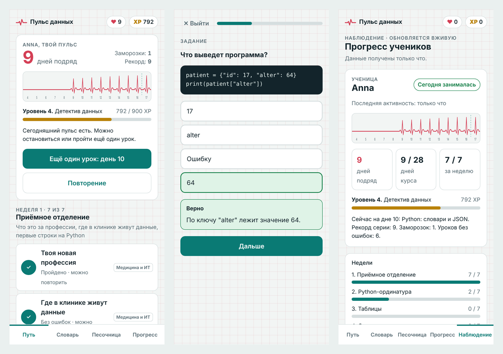
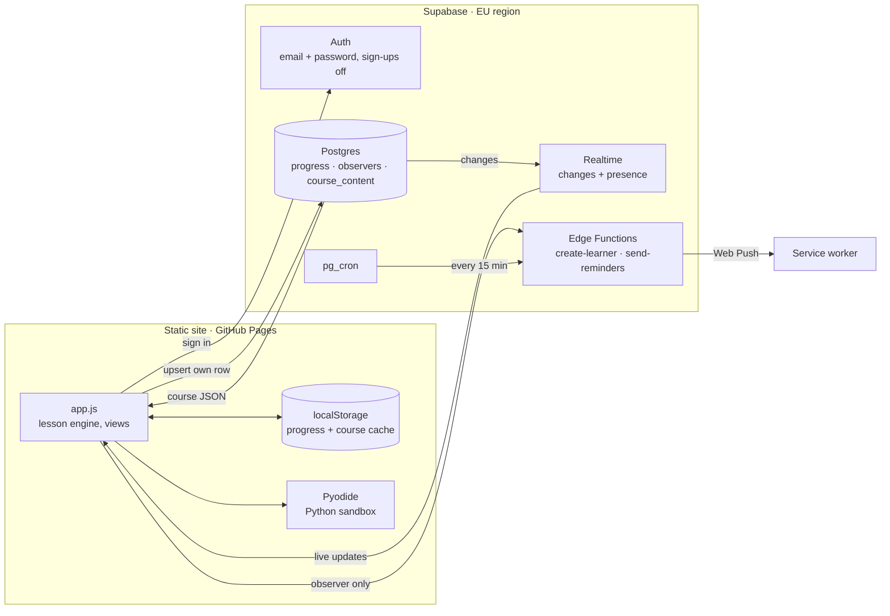

<div align="center">
  

  <h1>Pulse — Daily Learning Streak App</h1>
  <p><b>A one-lesson-a-day course engine with habit mechanics and a live progress dashboard for a mentor.<br>
  Vanilla JavaScript, Supabase Auth + Postgres Row Level Security + Realtime, static hosting.</b></p>

  <p>
    <a href="https://github.com/RuslanBaatyrbekov/pulse-learning/actions/workflows/ci.yml"></a>
    
    
    
    
    
  </p>
</div>

---

## Why

Online courses rarely fail on content. They fail on day 4, when the learner skips a session and never comes back.
Pulse is built around the habit, not the syllabus:

- One short lesson a day (15 minutes), with a hard cap of two new lessons per day so nobody burns out on a weekend.
- The streak is drawn as an ECG trace: a beat for every active day, a flat line for a missed one.
- Mistakes come back: a wrong task returns at the end of the lesson, and unresolved ones lead the review queue.
- A mentor (or a supportive partner) sees progress live without asking "did you study today?".

I built it to support a career change from medical technician to medical data science / digital health. The engine is content-agnostic: the course is a JSON document in the database.

## Features

| | |
|---|---|
| **Lesson flow** | Theory cards → tasks of four types: multiple choice, fill in the code, order the lines, match pairs. Wrong answers are re-queued until solved. Weekly checkpoint with 8 random tasks from the week plus a hands-on mission. |
| **Today screen** | One action card: today's lesson, or a celebration once the day is done, with the next step (another lesson or practice). The full path stays below. |
| **Habit mechanics** | Streak with freezes earned every 7 days, XP and 14 levels, badges, a 14-day pulse trace and a 5-week heatmap in the profile. |
| **Free practice** | Tasks from completed lessons by topic, mistakes first, then the least recently seen. A separate "fix my mistakes" run clears unresolved errors. |
| **Cheat sheets** | Searchable reference cards (tables, code, lists) stored in the course JSON: Python, pandas, SQL, plots, statistical tests, metrics, scikit-learn, FHIR, standards, regulation. |
| **Two-part glossary** | Domain terms in DE / EN / RU, and expandable programming concept cards (variable, list, loop, DataFrame, JOIN…) with an example, its output and a typical mistake. Both unlock lesson by lesson; examples open in the sandbox. |
| **Installable app, reminders** | Web app manifest and a service worker without caching. Daily Web Push at the learner's chosen hour, sent by a Supabase Edge Function on pg_cron, only if today's lesson is not done yet. |
| **Profile** | Avatar, seven themes, password change, progress backup code, onboarding tour with spotlight. |
| **Learning tracks** | A course can fork: weeks marked with a `track` stay hidden until the learner picks a path after the shared part, and the track can be switched later in settings. Progress and the observer view follow the chosen path. |
| **Python sandbox** | Code from lessons runs in the browser via Pyodide, no server needed. |
| **Sync** | Progress lives in `localStorage` and in Postgres. Last write wins on a client timestamp; offline sessions sync on reconnect or when the tab regains focus. Switching accounts on one device never leaks progress between users. |
| **Observer dashboard** | For users in the `observers` table: a compact list with live presence (Realtime Presence) and "last seen", sorting, and an expandable detail per learner: current lesson, streak, weekly activity, practice runs, opened cheat sheets and concept cards, unresolved mistakes by topic. Updated through Realtime, with polling as a fallback. The observer can create learner accounts (Edge Function `create-learner`, the secret key stays in Supabase) and upload a new course version from the app. |
| **Reliability** | Versioned script URLs against stale caches. Sign-out affects only the current device. A revoked or expired session leads back to the login screen with the email prefilled, local progress untouched. The browser Back button leaves a lesson and returns to the tab it was started from. |
| **Content behind auth** | Lessons and answers are served from the database to signed-in users only, cached for offline use and wiped on logout. The repository contains only the engine. |

## Architecture



Design notes:

- **Security lives in the database, not in the client.** Row Level Security policies in `schema.sql`:
  - a learner reads and writes only their own progress row;
  - an observer reads all rows and writes none;
  - course content is readable by signed-in users and writable only by observers;
  - push subscriptions belong to their owner; the reminder function reads them with the secret key on the server;
  - nothing can be deleted from the client, and the `anon` role has no table access.
  CI fails if a table is created without RLS.
- **Only the public key on the client.** `config.js` holds the project URL and the anon / publishable key, which grants nothing without a session. CI blocks commits containing service-role or secret keys.
- **Content Security Policy.** Scripts load only from the site and the Pyodide CDN. The Supabase client is vendored (`vendor/supabase.js`, 2.118.0) instead of loaded from a CDN.
- **No build step.** A handful of static files and a vendored library, readable top to bottom, deployable anywhere static.
- **State migrations without loss.** Every stored progress document goes through one normalizer: new fields are added, nothing is renamed or dropped, lesson ids are stable across course versions.

## Tech stack

JavaScript (ES5, no framework) · Supabase Auth · PostgreSQL with RLS · Supabase Realtime · Pyodide · GitHub Pages · GitHub Actions

## Quick start

1. Create a Supabase project (EU region recommended) and run `schema.sql` in the SQL Editor.
2. Load the example course: run `examples/course.example.sql`.
3. Turn off sign-ups in **Authentication → Providers → Email**, create users in **Authentication → Users**.
4. Make yourself an observer:
   ```sql
   insert into public.observers (user_id) select id from auth.users where email = 'you@example.com';
   ```
5. Put your project URL and anon key into `config.js`.
6. Optional, learner accounts from the app: deploy `supabase/functions/create-learner` (Edge Functions → Deploy a new function → via editor, "Verify JWT" off; the function checks the caller itself).
7. Optional, daily reminders: generate a VAPID key pair (`npx web-push generate-vapid-keys`), put the public key into `config.js` as `vapidPublic`, add the secrets `VAPID_PUBLIC`, `VAPID_PRIVATE` and a random `CRON_SECRET` in Edge Functions → Secrets, deploy `supabase/functions/send-reminders` with "Verify JWT" off, then run `push.sql` with your project ref and the cron secret filled in.
8. Serve the folder: `python3 -m http.server`, or push to GitHub and enable **Settings → Pages → Deploy from a branch**.

## Course format

A course is one JSON document: `weeks → days → cards + tasks + terms`, plus optional `notes` (cheat sheets) and `concepts` (programming cards, each unlocked by the lesson id in `after`). See `examples/course.example.json`.

```json
{ "t": "fill", "q": "Which function returns the number of items?",
  "code": "print(___(spo2))", "a": ["len"], "e": "len stands for length." }
```

## License

MIT
